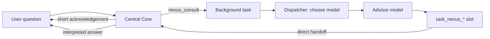

# Nexus Core

Nexus Core gives GLaDOS two independent capabilities backed by OpenAI-compatible APIs:

- **Consultation**: when switched on, GLaDOS may ask an external advisor model for help. She decides
  when; a dispatcher picks the model.
- **Base**: when this machine is too slow (or its model server is unreachable), Central Core itself
  runs on an API model, keeping GLaDOS's own prompt, personality and tools.

Both need an API key in the environment variable named by `api_key_env` (default `OPENAI_API_KEY`).
Without it Nexus does nothing: Central stays local and `nexus_consult` reports that no key is set.

## Consultation

Say "activate the Nexus Core" (tool `nexus_control`, action `on`). The state persists in
`data/nexus_settings.yaml`. While active, Central's context states that consulting is possible, gives
the estimated local first-reply time and the remaining daily budget, and offers `nexus_consult`.



1. GLaDOS calls `nexus_consult` with her `need`, a self-contained `question` and only the
   `context` the advisor requires. Nothing else from the conversation, memory or camera is sent.
2. The tool returns at once. GLaDOS acknowledges briefly and keeps talking about anything else.
   Consultations run on their own worker pool (`max_parallel`) and never hold local inference slots.
3. The dispatcher (`dispatcher`, a cheap model) receives the request, the model catalog, recorded
   results per model, operator preferences and the remaining budget, then returns any catalog model,
   a reasoning effort, an answer length and a free-text reason. An invalid choice falls back to the
   cheapest model.
4. The advisor answers GLaDOS, not the user, without a persona, as `{answer, confidence, caveats}`.
   If it fails, the dispatcher is asked once more and must choose a different model.
5. The completed task slot goes **directly** to Central Core, skipping the Autonomy reviewer: the user
   is already waiting for it. Delivery waits for an idle pause. Central interprets the advice and
   answers the original question in her own voice; she may doubt or correct it.

With Autonomy disabled, the call waits for the result like a synchronous tool. `cancel_task` stops a
consultation by its task ID; cancelled results are not delivered.

Preferences such as "always use the strongest model for code" are saved with `nexus_control`
(`prefer`, `clear_preferences`) and passed to the dispatcher.

## Base model

`base.mode`:

| Mode | Behaviour |
|---|---|
| `auto` | Central starts local. Switches to the API when the local server is unreachable, a probe estimates slow replies, or `window` consecutive real first replies exceed `latency_threshold_s` (median). Returns when a later probe falls below `latency_threshold_s * recover_ratio`. |
| `local` | Never switches. |
| `api` | Central always uses the API base. |

The probe loads the model, then times a fresh ~512-token prompt and extrapolates to
`typical_prompt_tokens`. It runs only while idle, every `reprobe_interval_s`, and never while real
local measurements are available. Switches apply between turns, never mid-reply.

The base model is `base.model`, or the cheapest catalog model with `tools: true`. Its
`reasoning_effort` defaults to `minimal` for voice latency. API failures, or an exhausted budget,
return Central to the local model; a failed API is not retried before `reprobe_interval_s`.

Only Central moves. Autonomy, Memory, Emotion, Search review and Vision stay on the local model:
their latency does not matter and API calls cost money. Native audio mode disables base switching
because it needs the local multimodal endpoint. One-token routing (llama.cpp only) keeps scoring on
the local model; speculative drafts are skipped while Central is remote.

## Budget

Every dispatcher, advisor and base call is charged from its reported token usage at the catalog
prices (`price_in`, `price_out`, USD per million tokens). When `daily_budget_usd` is spent,
consultations stop and the base returns to local until the next day.

## Configuration

```yaml
nexus:
  enabled: true
  api_url: "https://api.openai.com/v1/chat/completions"
  api_key_env: "OPENAI_API_KEY"
  dispatcher: "gpt-5-nano"
  daily_budget_usd: 0.50
  deadline_s: 180            # Whole consultation, including one retry
  request_timeout_s: 120
  max_answer_chars: 3000
  max_output_tokens: 1500
  max_parallel: 3
  models:                    # Any number of entries; replaces the default catalog
    - id: "gpt-5-nano"
      strengths: "short factual answers, rewording, simple lookups; fastest"
      price_in: 0.05
      price_out: 0.40
      reasoning: ["minimal", "low", "medium", "high"]
      tools: true
  base:
    mode: "auto"
    model: null
    reasoning_effort: "minimal"
    latency_threshold_s: 8
    recover_ratio: 0.6
    window: 3
    typical_prompt_tokens: 3000
    reprobe_interval_s: 600
```

Model IDs and prices are examples; check them against your account.

## Console

Facility Settings has a **Nexus Core** card: consultation on/off, base mode (auto, local only, API
only) and daily budget, plus the current base and its reason, the local estimate and today's
spending. It posts to `POST /api/nexus/settings` with any of `consultation` (bool), `base_mode` and
`daily_budget_usd`. Changes apply immediately and are saved to `data/nexus_settings.yaml`, where they
override the YAML configuration. Switching to auto re-measures the local model on the next idle run.
