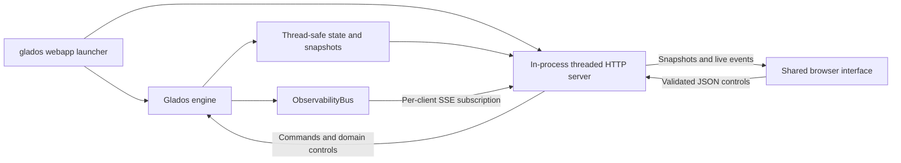

# Webapp architecture — implemented

Reviewed **2026-10-11** against the active UI branch. This is the current design,
not a checklist for rebuilding the initial observability-only console.
Operational setup, endpoints and payloads are in [docs/webapp.md](../docs/webapp.md).

## Launcher and engine

`glados webapp` is a dedicated launcher in `cli.py`. It loads merged config/CLI
settings, refuses a disabled console, constructs Glados and starts WebappServer.
Bind failure aborts this launcher. It runs the engine and shuts the server down
in `finally`. Server lifetime follows the launcher process; it is not a separate
engine/GPU service.

The shared config contains WebappConfig, whose enabled field defaults false.
The shipped webapp profile enables it explicitly. `glados start`, `tui` and
`say` do not start this HTTP console. WebSocket audio is a separate optional
backend/port, so these commands are not guaranteed to bind no network ports.

## Reads and controls

The server serializes live minds, evidence slots, tasks, inference lanes,
interaction/audio, vision, emotion, MCP and tool catalogs. Reads use the engine's
thread-safe APIs; they are not lock-free. Control endpoints invoke engine/store
operations and therefore are not read-only. Shared state remains owned by its
existing stores rather than by a web-specific mirror.

The public API retains `/api/state`, `/api/minds` and `/api/agents`, even though
the frontend mostly consumes snapshots/SSE. It also exposes context inspection,
memory read/edit, tasks/cancellation, device selection, search/vision settings,
routing list CRUD/tests, native command tests and response instructions. See the
[endpoint inventory](../docs/webapp.md#endpoints) for the complete table.

Loopback is the default bind. Host checks apply to reads and writes; wildcard
binding requires explicit allowed hosts. JSON mutations check Origin/body limits,
and sensitive context/memory/camera reads have same-origin checks. This is not an
authentication service. Request errors cannot guarantee every possible socket
exception becomes JSON, but do not intentionally terminate the engine.

## Telemetry

ObservabilityBus retains bounded history and its TUI drain FIFO. Each SSE client
gets a private bounded subscription queue, avoiding competing consumers. A slow
subscriber drops old events; reconnect obtains a current snapshot plus bounded
history rather than replaying an unbounded log.

SSE sends `obs`, `state`, `snapshot`, `audio`, `camera` and `performance` events.
Fast audio/camera/playback updates drive the avatar without repainting the whole
console. Revisions/timestamps prevent slower snapshots from replacing newer
controls. Historical telemetry never replays actual audio.

## Shared UI surfaces

The default basic surface shows the Portal banner, eye/camera and text input.
Detailed mode exposes existing menus without rearranging them. Basic/detailed
switching uses shared DOM/state and preserves an unsent message and camera stream.
Presence provides tablet controls and dialogue beneath the eye, separate from
the camera. Desktop landscape and tablet portrait/landscape are the layout targets.

The boot screen tracks interface/eye/snapshot/live-telemetry readiness, supports
skip/reduced motion and releases after a bounded disconnected wait. It does not
prove model inference or microphone health. Offline HTTP mode retries instead of
inventing active cores. Only a direct local-file demonstration uses simulated data.

Themes and camera treatments are local browser presentation; Vision receives
original frames. PotatOS uses the supplied transparent extended-ribbon PNG with
its cable behind the basic banner. All surfaces share engine controls and speech
animation; they do not create extra inference/audio pipelines.

## Tests and remaining boundary

`test_webapp.py`, `test_webapp_hosts.py`, `test_webapp_env.py` and
`webapp_client.cjs` cover served assets, HTTP/state/control contracts, host/origin
checks, context/routing/memory rendering, loading and surface changes.

A shared typed runtime-status projection remains a useful refactor. Keep runtime
execution state separate from semantic slot evidence; neither API retirement nor
replacing ObservabilityBus is required for the UI to work.
